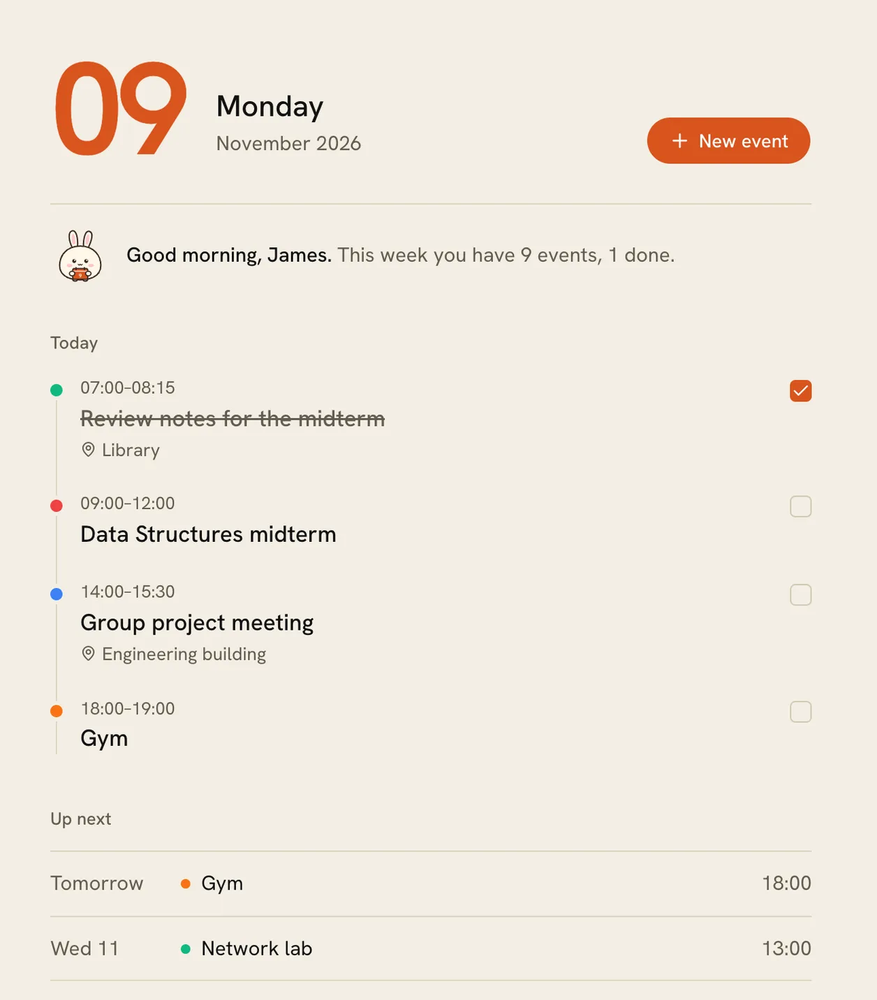
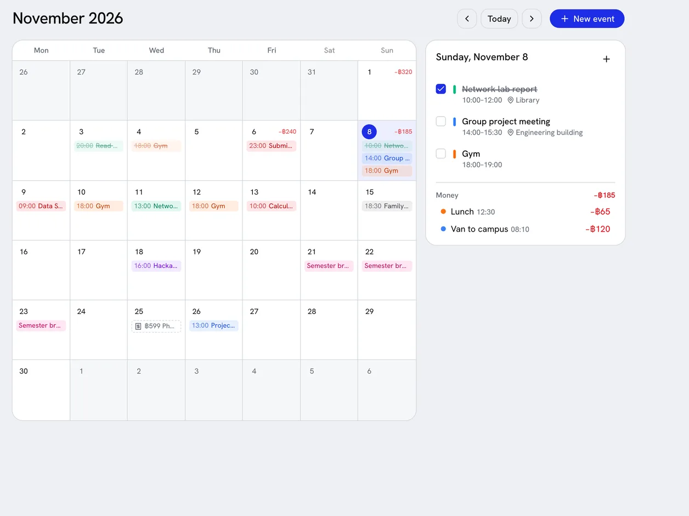

# jameswebpupu

A personal site with two parts: a public bilingual portfolio at `/` and `/th`, and a private planner at `/app` (calendar, notes, a money summary and a contact inbox). It runs on Cloudflare Workers.

<p>
  
  
</p>

## What it does

- **Portfolio** (English and Thai): static pages served straight from the Worker's assets, with a contact form and one-page resume PDFs.
- **Planner** at `/app`, behind a password login:
  - Today: the day as a timeline, what comes next, a quick note, recent notes.
  - Calendar: a month view with all-day and multi-day events, a done checkbox and a side panel per day.
  - Notes: search, pin, Markdown text.
  - Messages from the portfolio's contact form, shown on Today.
  - Money: this month's income and spending, read from a separate expenses app over a read-only API.
  - Settings: weekly backups (download any of them), a cookie-free visit counter for the portfolio, and install-as-app.
- **MCP server** at `/api/mcp`: an MCP client such as Claude can read the schedule, add or change events, write notes, read contact messages and see visit stats.
- Light and dark themes, installable as a PWA, English UI.

## Stack

- Next.js 16 (App Router), TypeScript, Tailwind CSS 4, shadcn/ui, lucide-react
- Cloudflare Workers via [OpenNext](https://opennext.js.org/cloudflare), D1 (SQLite), KV for backups
- Zod for validation, a small hand-written JSON-RPC handler for MCP (Streamable HTTP, stateless)

## Layout

```
public/portfolio/        the portfolio pages (index.html, th.html), images and resumes
public/assets/           CSS and JS the portfolio uses
src/app/app/             the private planner pages (/app, /app/calendar, /app/notes, ...)
src/app/api/             REST API (login required) and /api/mcp
src/components/app/      planner UI
src/lib/server/          D1 access, auth, login lockout, messages, money client, MCP tools
src/lib/                 shared helpers (time zone, backups, visit counter)
migrations/              D1 schema
custom-worker.ts         Worker entry: serves the portfolio, counts visits, runs the weekly backup
```

## Run it locally

```bash
npm install
cp .dev.vars.example .dev.vars      # set ADMIN_PASSWORD, SESSION_SECRET and MCP_TOKEN
npm run db:migrate:local
npm run dev                          # http://localhost:3000
```

To try it on the real Workers runtime: `npm run preview`.

## Deploy

```bash
npx wrangler login
npx wrangler d1 create my-website-db           # put the database_id in wrangler.jsonc
npx wrangler kv namespace create my-website-backups   # put the id in wrangler.jsonc
npm run db:migrate:remote
npx wrangler secret put ADMIN_PASSWORD
npx wrangler secret put SESSION_SECRET
npx wrangler secret put MCP_TOKEN
npm run deploy
```

After that, every push to `main` can build and deploy through Cloudflare Workers Builds
(build: `npx opennextjs-cloudflare build`, deploy: `npx opennextjs-cloudflare deploy`).
Run `npm run db:migrate:remote` before pushing a change that adds a migration.

## Connecting an MCP client

Log in and open **Claude** in the menu: it shows the connector URL (it contains the secret token) and a ready-made command for Claude Code. The tools are `get_summary`, `list_events`, `search_events`, `create_event`, `update_event`, `delete_event`, `list_notes`, `get_note`, `create_note`, `update_note`, `delete_note`, `list_messages`, `mark_message_read` and `get_portfolio_stats`.

## Security notes

- The planner uses one password. After 5 wrong tries in 15 minutes an IP is locked out for 15 minutes.
- Sessions are signed cookies (HMAC); the MCP endpoint needs its own secret token.
- Secrets live in Cloudflare secrets and `.dev.vars` (never committed).
- The contact form has a hidden honeypot field and a per-IP limit, and stores only what the visitor typed.
- The visit counter stores a day, a path, the referring domain and a country code. No cookies, no IP addresses.

## Time zone

All dates are handled in Asia/Bangkok (UTC+07:00). Change `TZ_OFFSET` in `src/lib/time.ts` to use another fixed offset.

## Related

The money numbers come from a separate expenses app through `/api/integration/v1/*`, called over a Cloudflare service binding. Its repository is private.
